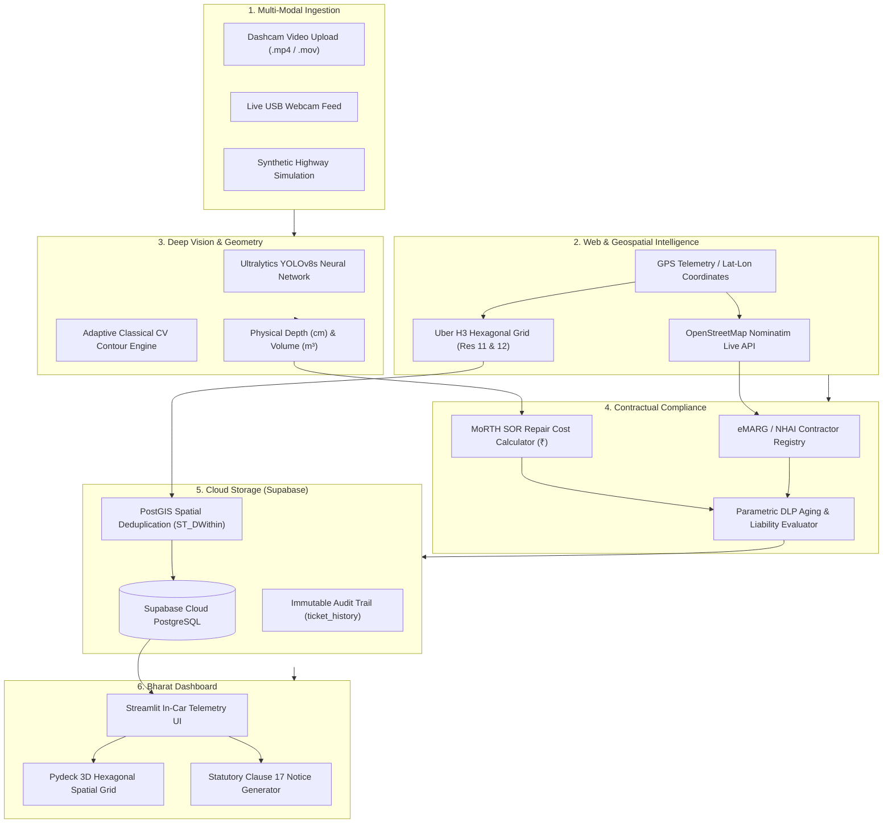

# 🛡️ PathGuard-AI: Bharat Infrastructure Assessment Engine

[](https://python.org)
[](https://ultralytics.com)
[](https://supabase.com)
[](https://postgis.net)
[](https://h3geo.org)
[](https://streamlit.io)

> **Autonomous Road Infrastructure Quality & Statutory Contractual Compliance Engine**  
> *Developed for MoRTH (Ministry of Road Transport & Highways), eMARG (PMGSY), and NHAI Defect Liability Audits.*

---

## 📌 Executive Summary

India spends thousands of crores annually on highway construction and maintenance under **MoRTH**, **NHAI EPC Contracts**, and the **PMGSY (eMARG)** scheme. However:
1. **Defects go unpenalized** because manual inspections are slow, subjective, and corruptible.
2. **Contractors escape liability** during the statutory 5-Year / 10-Year Defect Liability Period (DLP).
3. **Potholes are repeatedly counted**, inflating repair estimates and municipal budgets.

**PathGuard-AI** solves this end-to-end:
* 📹 **Detects Road Damage:** Runs real-time computer vision on dashcam video uploads or live camera streams.
* 📏 **Measures True Physical Geometry:** Computes true width ($W_{cm}$), length ($L_{cm}$), depth ($D_{cm}$), and volume ($V_{m^3}$) of each defect.
* 🌐 **Live Web Road Detection:** Uses real-time OpenStreetMap reverse geocoding to identify the exact road, jurisdiction, and pavement standard from GPS coordinates.
* 🏢 **Auto-Matches Contractors:** Automatically identifies the responsible contractor, contract ID, compliance email, and active DLP expiry.
* 📍 **Uber H3 & PostGIS Deduplication:** Snaps defects to Uber H3 hexagons (`Res 11` corridor & `Res 12` defect) and performs spatial radius deduplication (`ST_DWithin 3m`) on **Supabase Cloud**.
* ⚖️ **Automates Legal Liability:** Generates legally binding **Statutory Notices of Liability under Clause 17** with a 14-day cure period and estimated repair costs calculated using MoRTH Schedule of Rates (SOR ₹/m³).

---

## 🏛️ System Architecture



> 📖 *For complete technical and mathematical specifications, see [`docs/ARCHITECTURE.md`](docs/ARCHITECTURE.md).*

---

## ✨ Key Features & Capabilities

### 1. 🌐 Live Web Road Detection from Coordinates
Enter any Latitude and Longitude in India (or select from Highway Presets like NH-48, NH-44, or Mumbai-Pune Expressway). The system makes a real-time live call to the **OpenStreetMap Web API** to auto-resolve:
* Real road name (e.g. `Delhi-Gurugram Expressway`)
* District & State jurisdiction (e.g. `Gurugram, Haryana`)
* Pavement standard (Flexible Bituminous Asphalt vs Rigid Concrete)

### 2. 🏢 Automated Contractor & DLP Liability Matching
Automatically matches the road section against the national highway registry:
* Assigns the responsible contractor (e.g. `L&T Infrastructure Engineering Ltd`, `Navayuga Engineering`, `IRB Infrastructure`)
* Resolves the official contract ID, contractor compliance email, and statutory DLP expiry date.

### 3. 📹 Real-Time Video Upload & Live Feed Processing
* Supports direct drag-and-drop of `.mp4`, `.mov`, and `.avi` dashcam videos.
* Processes frames in real-time with dual-engine AI:
  * **YOLOv8 Deep Neural Network** trained on the 665-image Roboflow Pothole dataset.
  * **Adaptive Classical CV Fallback** for guaranteed execution across any hardware.

### 4. ☁️ Supabase Cloud Database (PostgreSQL + PostGIS)
* **Zero local database hassle:** Fully migrated away from Docker and local VMs to **Supabase Cloud**.
* **Spatial Deduplication:** Uses PostGIS `ST_DWithin(geom, 3.0 meters)` to ensure potholes driven over multiple times are merged into a single master ticket instead of duplicated.

### 5. ⚖️ Automated Statutory eMARG Notice (Clause 17)
* Automatically generates formal Notice of Liability documents citing Clause 17.
* Computes repair liability in Indian Rupees (₹) using government Schedule of Rates (SOR).
* Establishes a 14-business-day statutory cure deadline before authorizing third-party repair against performance bank guarantees.

---

## 📂 Project Structure

```
PATH_GUARD/
├── config/                  # Configuration files
│   ├── default_config.yaml  #   Default system settings (DLP rules, SOR rates, camera)
│   └── supabase_config.yaml #   Supabase connection template
├── data/                    # Dataset storage
│   ├── pothole_dataset.yaml #   Roboflow YOLOv8 665-image dataset configuration
│   └── Pothole.v1-raw.yolov8#   Train / Validation / Test images & labels
├── docs/                    # Documentation
│   ├── ARCHITECTURE.md      #   System architecture, sequence diagrams & formulas
│   └── pathguard_implementation_plan.pdf
├── pathguard/               # Core Python Engine
│   ├── __init__.py
│   ├── config.py            #   Config loader with .env and environment variable overrides
│   ├── vision.py            #   Module 1: Enhanced Vision Pipeline (YOLOv8 + Classical CV)
│   ├── spatial.py           #   Module 2: Uber H3 Geospatial Indexing
│   ├── geocoding.py         #   Module 2: Live OpenStreetMap Reverse Geocoding & Contractor Resolver
│   ├── database.py          #   Module 2: PostGIS Deduplication Engine & Supabase Client
│   ├── contracts.py         #   Module 3: DLP Aging & Wear-vs-Workmanship Engine
│   ├── notices.py           #   Module 4: Statutory eMARG Notice Dispatcher
│   ├── pdf_ingest.py        #   Tender document ingestion (PyMuPDF)
│   ├── gps_relay.py         #   GPS interface (Simulated & NMEA hardware)
│   └── ml/                  #   Machine Learning subsystem (trainer, depth, datasets)
├── dashboard.py             # Streamlit Bharat Edition Live Dashboard
├── main_engine.py           # Headless CLI orchestration pipeline
├── train.py                 # ML training CLI
├── .env.example             # Template for Supabase credentials
├── pyproject.toml           # Project metadata
├── requirements.txt         # Python dependencies
└── README.md                # Project documentation
```

---

## 🚀 Quick Start Guide

### 1. Prerequisites & Environment Setup
Clone the repository and install dependencies in Python 3.11:
```powershell
# Clone the repository
git clone https://github.com/monishchaparla/PathGuard-AI.git
cd PathGuard-AI

# Create virtual environment
python -m venv venv
.\venv\Scripts\Activate.ps1

# Install dependencies
.\venv\Scripts\python -m pip install -r requirements.txt
```

### 2. Configure Your Supabase Cloud Database (Free & Takes 2 Mins)
1. Sign up for free at **[supabase.com](https://supabase.com)** and create a new project.
2. In the Supabase **SQL Editor**, run the SQL commands from [`scripts/init_db.sql`](scripts/init_db.sql).
3. Copy your project connection URI from **Project Settings ➔ Database ➔ Connection string (URI)**.
4. Copy [`.env.example`](.env.example) to `.env` and paste your credentials:
   ```ini
   DATABASE_HOST=db.yourprojectref.supabase.co
   DATABASE_PORT=5432
   DATABASE_NAME=postgres
   DATABASE_USER=postgres
   DATABASE_PASSWORD=YourDatabasePassword
   DATABASE_SSLMODE=require

   SUPABASE_URL=https://yourprojectref.supabase.co
   ```
   *(Note: You can also enter and test your Supabase credentials directly through the dashboard UI sidebar!)*

### 3. Launch the Live Dashboard
```powershell
.\venv\Scripts\python -m streamlit run dashboard.py
```
Open **`http://localhost:8501`** in your browser.

---

## 🎯 Defect Taxonomy (IRC:82-2015 Standard)

| ID | Defect Classification | IRC Specification | Typical DLP Remedy |
|---|---|---|---|
| **0** | **Pothole** | IRC:82-2015 §3.1 | Mill & Patch with Bituminous Concrete (BC) |
| **1** | **Longitudinal Crack** | IRC:82-2015 §3.2 | Polymer-modified asphalt crack sealing |
| **2** | **Transverse Crack** | IRC:82-2015 §3.3 | Routing and hot-applied rubberized sealant |
| **3** | **Alligator Cracking** | IRC:82-2015 §3.4 | Structural base failure: Full-depth excavation |
| **4** | **Rutting** | IRC:82-2015 §3.5 | Surface micro-milling & Dense Bituminous Macadam |
| **5** | **Raveling** | IRC:82-2015 §3.6 | Bituminous slurry seal / Fog seal |
| **6** | **Defective Patching** | IRC:82-2015 §3.7 | Complete edge-cut milling and re-laying |

---

## 📜 Statutory Legal Framework

* **MoRTH Standard EPC Agreement (Clause 17):**
  * Mandates a **5-Year Defect Liability Period (DLP)** for Bituminous Flexible Pavements.
  * Mandates a **10-Year DLP** for Rigid Cement Concrete Pavements.
  * Authorizes issuing a formal notice with a **14-business-day cure period**.
* **eMARG (electronic Maintenance of Rural Roads under PMGSY):**
  * Requires mandatory geo-tagged condition surveys during the 5-year maintenance period.
* **CPWD General Conditions of Contract (Clause 17 & 35):**
  * 1-Year maintenance liability for urban civil and municipal roadway works.

---

## 👥 Hackathon Team & Credits

* **Monish Chaparla** ([@monishchaparla](https://github.com/monishchaparla))
* **Hasini Priya** ([@Hasini-priya](https://github.com/Hasini-priya))
* **Mamatha Malapati** ([@Malapati-mamatha-9719](https://github.com/Malapati-mamatha-9719))
* **Likhitha** ([@likhitha7815-gif](https://github.com/likhitha7815-gif))

---

## 📄 License

Developed for the Student AI & Smart Cities Hackathon. All rights reserved.
