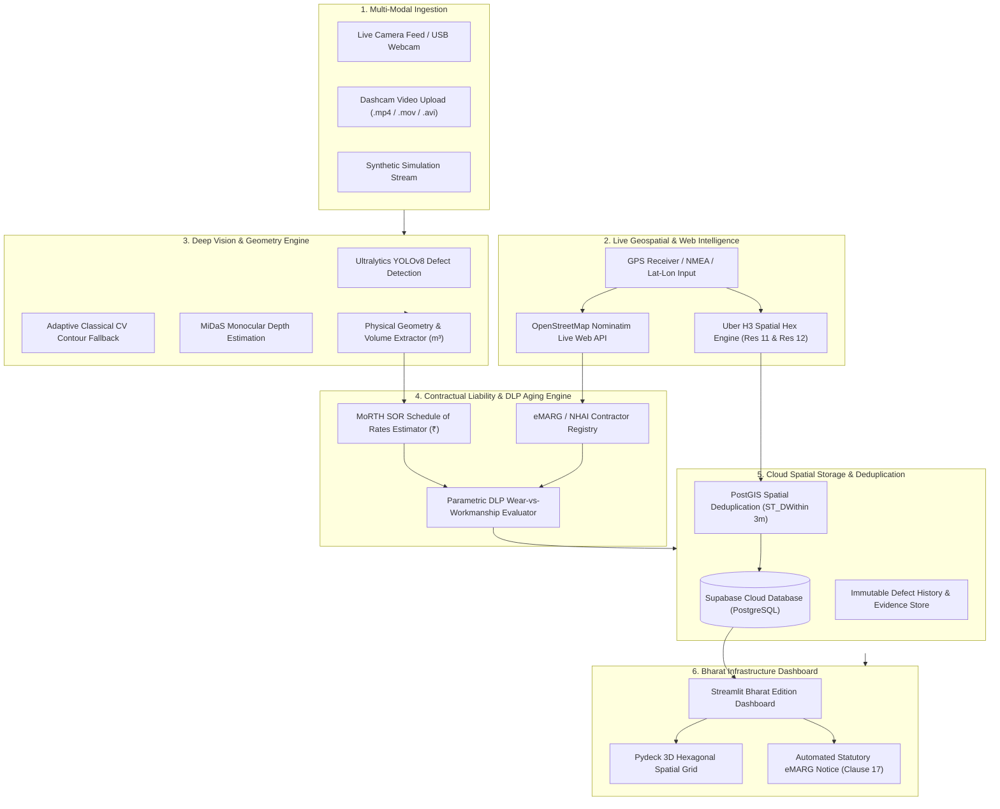
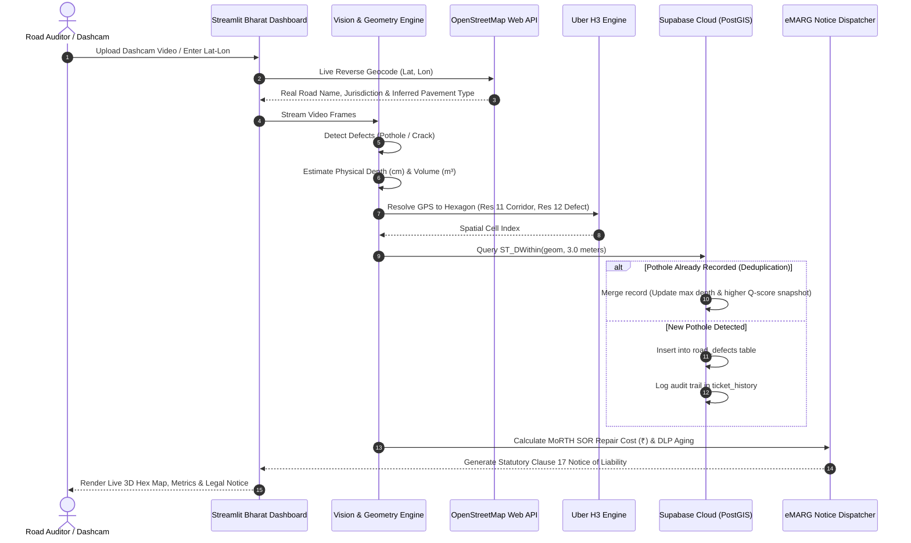

# 🏛️ PathGuard-AI: System Architecture & Technical Specifications

> **Autonomous Road Infrastructure Quality & Contractual Compliance Engine**  
> *Built for Ministry of Road Transport & Highways (MoRTH), eMARG (PMGSY), and NHAI Contract Compliance.*

---

## 1. High-Level System Architecture

PathGuard-AI bridges the gap between **Real-Time Edge Computer Vision** and **Automated Statutory Legal Enforcement**. The architecture is structured into six modular subsystems:



---

## 2. End-to-End Execution Sequence



---

## 3. Subsystem Breakdown

### 3.1 Vision & Physical Geometry Engine (`pathguard/vision.py`)
* **Detection Modes:**
  * **YOLOv8s Deep Neural Network:** Fine-tuned on the 665-image Roboflow Pothole dataset for bounding-box defect localization.
  * **Classical Computer Vision Fallback:** High-performance adaptive Gaussian thresholding, morphological opening/closing, and contour analysis ensuring uninterrupted execution even without GPU compilation.
* **Monocular Depth & Volume:**
  * Uses camera optical parameters (mount height, focal length, sensor geometry) combined with MiDaS monocular depth maps to calculate true physical width ($W_{cm}$), length ($L_{cm}$), and depth ($D_{cm}$).
  * Pothole Volume ($V_{m^3}$) is derived assuming semi-ellipsoidal defect topology:
    $$V = \frac{2}{3} \pi \left(\frac{W}{2}\right) \left(\frac{L}{2}\right) D \times 10^{-6}$$

### 3.2 Live Web Geocoding & Contractor Matching (`pathguard/geocoding.py`)
* **Live OpenStreetMap Integration:**
  * Direct asynchronous HTTP queries to the OSM Nominatim reverse-geocoding engine.
  * Real-time extraction of live road name (`road`), classification (`motorway`, `trunk`, `primary`, `tertiary`), district, and state.
* **Automated Contractor & DLP Registry:**
  * Automatically maps road jurisdictions to active highway contracts (e.g. NHAI EPC contracts, State PWD, PMGSY Rural Roads).
  * Automatically resolves: Contractor Organization, Contract ID, Official Compliance Email, Supervising Engineer, and Defect Liability Expiry Date.

### 3.3 Spatial Hexagonal Deduplication (`pathguard/spatial.py` & `pathguard/database.py`)
* **Uber H3 Multi-Resolution Indexing:**
  * **Resolution 11 (~300m):** Identifies the macro road corridor sector.
  * **Resolution 12 (~9m²):** High-precision defect pinning matching vehicle lane width.
* **PostGIS Spatial Deduplication (`ST_DWithin`):**
  * Multiple passes by different patrol vehicles over the same pothole are spatial-indexed.
  * If a defect is detected within a 3.0-meter radius, the system **merges** the ticket instead of duplicating it, updating the record with the maximum observed depth and highest quality snapshot.

### 3.4 Statutory Liability & Notice Engine (`pathguard/contracts.py` & `pathguard/notices.py`)
* **DLP Regulatory Taxonomies:**
  * **Bituminous Asphalt Pavements:** 5-Year DLP under MoRTH Standard EPC Clause 17.
  * **Cement Concrete Pavements:** 10-Year DLP under IRC:58 / NHAI BOT standards.
  * **PMGSY Rural Roads:** 5-Year DLP with bi-monthly geo-tagged audits under eMARG.
  * **Urban Municipal Works:** 1-Year DLP under CPWD General Conditions of Contract.
* **Parametric Workmanship Scoring ($S_d$):**
  $$S_d = S_{severity} \times \left(1.0 - \frac{Age_{months}}{DLP_{months}}\right) \times \left(\frac{ESAL_{actual}}{ESAL_{design}}\right)$$
* **Automated Notice Generation:**
  * Produces formatted **Statutory Notices of Liability** citing Clause 17 with an explicit **14-business-day cure period**.
  * Quantifies contractor liability using Schedule of Rates (SOR ₹/m³).

### 3.5 Cloud Database Architecture (Supabase Cloud PostgreSQL + PostGIS)
* **Hosted on Supabase Cloud** (`PostgreSQL 15+` with `PostGIS 3.4+`):
  * **`road_defects`:** Core defect register with PostGIS `GEOMETRY(Point, 4326)`, physical dimensions, severity, contractor metadata, and status.
  * **`ticket_history`:** Immutable append-only audit trail logging every detection pass, merge action, and JSON telemetry payload.
  * **`contracts`:** Active contractor registry with H3 corridor coverage arrays and retention release lock status.

---

## 4. Database Schema Reference

```sql
CREATE EXTENSION IF NOT EXISTS postgis;
CREATE EXTENSION IF NOT EXISTS pgcrypto;

-- Defects register
CREATE TABLE road_defects (
    ticket_id TEXT PRIMARY KEY,
    h3_res11 TEXT NOT NULL,
    h3_res12 TEXT NOT NULL,
    geom GEOMETRY(Point, 4326) NOT NULL,
    width_cm REAL NOT NULL,
    length_cm REAL NOT NULL,
    depth_cm REAL NOT NULL,
    volume_m3 REAL NOT NULL,
    severity TEXT NOT NULL CHECK (severity IN ('LOW','MEDIUM','HIGH','CRITICAL')),
    best_q_score REAL NOT NULL DEFAULT 0.0,
    best_image_path TEXT,
    road_name TEXT,
    road_type TEXT,
    contract_id TEXT,
    contractor_name TEXT,
    status TEXT DEFAULT 'OPEN',
    created_at TIMESTAMP DEFAULT NOW(),
    updated_at TIMESTAMP DEFAULT NOW()
);

-- Historical audit trail
CREATE TABLE ticket_history (
    id TEXT PRIMARY KEY,
    ticket_id TEXT REFERENCES road_defects(ticket_id),
    action_type TEXT NOT NULL,
    q_score REAL,
    depth_cm REAL,
    image_path TEXT,
    detection_data JSONB,
    timestamp TIMESTAMP DEFAULT NOW()
);

-- Spatial Indices
CREATE INDEX idx_defects_geom ON road_defects USING GIST(geom);
CREATE INDEX idx_defects_h3_res12 ON road_defects(h3_res12);
CREATE INDEX idx_defects_h3_res11 ON road_defects(h3_res11);
```
